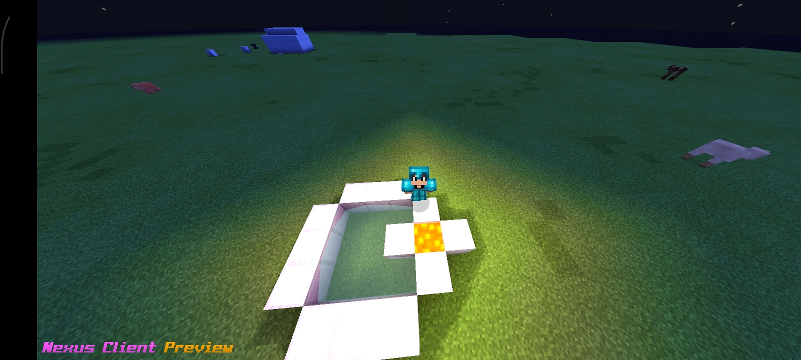

# NexusClient-MCPE
# Nexus Client

Client de Minecraft PE 0.14.3
É um client leve que funciona em Androids antigos até os mais novos como Android 15!
Já vem com Servers e Shaders!

---

### Preview do Client:

---

### Links Úteis:
* **Site Antigo:** [nexusmcpe.netlify.app](https://nexusmcpe.netlify.app/)
* **Novo Site:** [nexusclientmcpe.netlify.app](https://nexusclientmcpe.netlify.app/)
* **Discord Oficial:** [discord.gg/t5dHV4xXC](https://discord.gg/t5dHV4xXC)
* 
